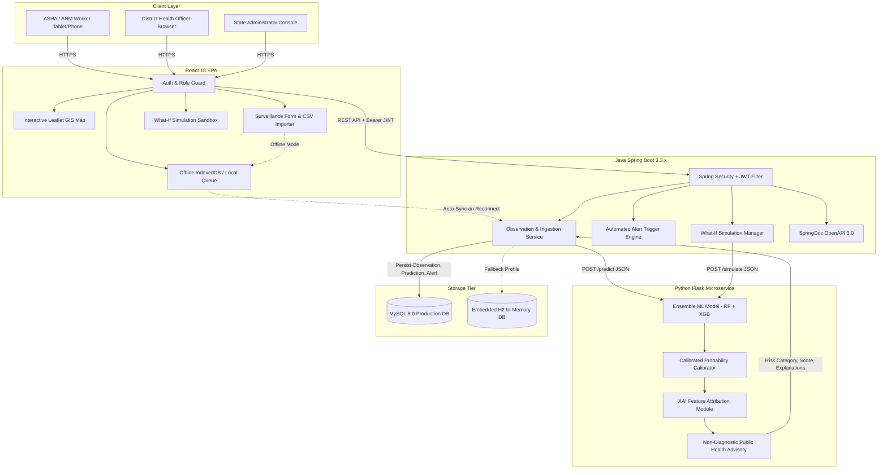

# System Architecture & Technical Design Document

## Project: Smart Community Health Monitoring & Early Warning System (Rural Northeast India)

---

## 1. High-Level Architecture

The system employs a decoupled, microservice-oriented architecture comprising four core tiers:
1. **Frontend Presentation Tier**: React 18 Single Page Application (SPA) with Leaflet.js GIS, Recharts, and LocalStorage offline queuing.
2. **Surveillance & API Tier**: Java Spring Boot 3.3.x providing secured REST endpoints, JWT authentication, and automated alert triggering.
3. **AI/ML Risk Inference Tier**: Python 3.14 Flask microservice providing ensemble classification (Random Forest + Gradient Boosting), Explainable AI (XAI) feature attribution, and What-If counterfactual simulations.
4. **Data Tier**: Dual-mode database layer supporting MySQL 8.0 for production and embedded H2 in-memory mode for zero-friction academic demonstrations.

---

## 2. Database Entity Relationship (ER) Diagram

```mermaid
erDiagram
    ROLES ||--o{ USERS : "assigned to"
    DISTRICTS ||--o{ VILLAGES : "contains"
    DISTRICTS ||--o{ USERS : "supervises"
    USERS ||--o{ VILLAGES : "contact ASHA"
    USERS ||--o{ OBSERVATIONS : "records"
    VILLAGES ||--o{ OBSERVATIONS : "located in"
    OBSERVATIONS ||--|| PREDICTIONS : "generates"
    VILLAGES ||--o{ PREDICTIONS : "evaluates"
    PREDICTIONS ||--o{ PREDICTION_EXPLANATIONS : "explained by"
    PREDICTIONS ||--o| ALERTS : "triggers"
    VILLAGES ||--o{ ALERTS : "alerts for"
    USERS ||--o{ ALERTS : "reviews"
    USERS ||--o{ SIMULATION_RUNS : "executes"
    VILLAGES ||--o{ SIMULATION_RUNS : "simulates"
    USERS ||--o{ SYNC_LOGS : "audits"

    ROLES {
        bigint id PK
        varchar name UK
        varchar description
    }

    DISTRICTS {
        bigint id PK
        varchar state
        varchar district_name
        varchar district_code UK
        int total_population
        varchar primary_river_basin
    }

    USERS {
        bigint id PK
        varchar username UK
        varchar password_hash
        varchar full_name
        varchar email UK
        varchar phone
        bigint role_id FK
        varchar state
        bigint district_id FK
        varchar sub_centre
        boolean is_active
    }

    VILLAGES {
        bigint id PK
        bigint district_id FK
        varchar village_name
        varchar village_code UK
        varchar sub_centre
        decimal latitude
        decimal longitude
        int estimated_population
        varchar primary_water_source
        decimal sanitation_coverage_pct
        varchar flood_vulnerability_index
        bigint contact_asha_id FK
    }

    OBSERVATIONS {
        bigint id PK
        bigint village_id FK
        bigint recorded_by_user_id FK
        date observation_date
        decimal rainfall_mm
        varchar water_source_type
        decimal turbidity_ntu
        decimal ph_level
        boolean e_coli_detected
        decimal residual_chlorine_ppm
        boolean chlorination_done
        decimal latrine_coverage_pct
        boolean open_drainage_flag
        int reported_diarrhea_cases
        int reported_cholera_suspects
        int reported_typhoid_suspects
        int total_gastro_cases
        text notes
        varchar submission_channel
        varchar sync_status
    }

    PREDICTIONS {
        bigint id PK
        bigint observation_id FK
        bigint village_id FK
        decimal risk_score
        varchar risk_category
        decimal confidence_pct
        varchar model_version
        varchar model_type
        decimal rainfall_factor_pct
        decimal water_quality_factor_pct
        decimal case_trend_factor_pct
        decimal sanitation_factor_pct
        text summary_recommendation
    }

    PREDICTION_EXPLANATIONS {
        bigint id PK
        bigint prediction_id FK
        varchar factor_key
        varchar factor_name
        varchar factor_value
        varchar impact_direction
        decimal contribution_weight
        text explanation_text
    }

    ALERTS {
        bigint id PK
        bigint prediction_id FK
        bigint village_id FK
        varchar alert_code UK
        varchar alert_level
        text trigger_reason
        text recommended_actions
        varchar status
        bigint reviewed_by_user_id FK
        timestamp reviewed_at
        text resolution_notes
    }

    SIMULATION_RUNS {
        bigint id PK
        bigint user_id FK
        bigint village_id FK
        decimal base_rainfall_mm
        decimal simulated_rainfall_mm
        decimal rainfall_delta_pct
        decimal base_risk_score
        varchar base_risk_category
        decimal simulated_risk_score
        varchar simulated_risk_category
        decimal delta_score
    }

    SYNC_LOGS {
        bigint id PK
        varchar client_sync_id
        bigint user_id FK
        int records_synced
        int conflicts_resolved
        varchar status
    }
```

---

## 3. Machine Learning & Explainable AI (XAI) Formulation

### Composite Risk Formulation
The community-level disease risk score $R \in [0.0, 100.0]$ is computed via an ensemble ML classifier calibrated with the following epidemiological vector weights:

$$R = 0.35 \cdot W(t, e, c) + 0.25 \cdot H(r) + 0.25 \cdot C(d, s_c, s_t) + 0.15 \cdot S(l, o)$$

Where:
- $W(t, e, c)$: **Water Contamination Index** combining Turbidity ($t$ NTU), $E. coli$ presence ($e \in \{0,1\}$), and Free Residual Chlorine ($c$ ppm).
- $H(r)$: **Hydrological Runoff Hazard** as a non-linear function of Monsoon Rainfall ($r$ mm).
- $C(d, s_c, s_t)$: **Syndromic Outbreak Cluster Score** weighting acute diarrhea ($d$), suspected cholera ($s_c$), and suspected typhoid ($s_t$).
- $S(l, o)$: **Sanitation Vulnerability Baseline** derived from village latrine coverage percentage ($l$) and open drainage proximity ($o$).

### Risk Classification Tiers
- **Low Risk ($R < 35.0$)**: Routine weekly surveillance; optimal residual disinfection maintained.
- **Medium Risk ($35.0 \le R < 70.0$)**: Precautionary chlorine distribution; 48-hour syndromic tracking.
- **High Outbreak Risk ($R \ge 70.0$)**: Immediate boil-water notice; super-chlorination of community sources; door-to-door ASHA hydration depot deployment.

---

## 4. Security & Role-Based Access Control (RBAC)

1. **Password Hashing**: BCrypt with work factor 10.
2. **Session Authentication**: Stateless JSON Web Tokens (JWT) signed with HMAC-SHA256 (`HS256`).
3. **Role Hierarchy**:
   - `ROLE_ADMIN`: Full administrative control, user provisioning, village registration, and system settings.
   - `ROLE_DISTRICT_OFFICER`: District-level surveillance, GIS map analysis, alert review/resolution, and CSV report export.
   - `ROLE_ASHA_WORKER`: Village-level observation recording, offline draft caching, and risk explanation viewing.
